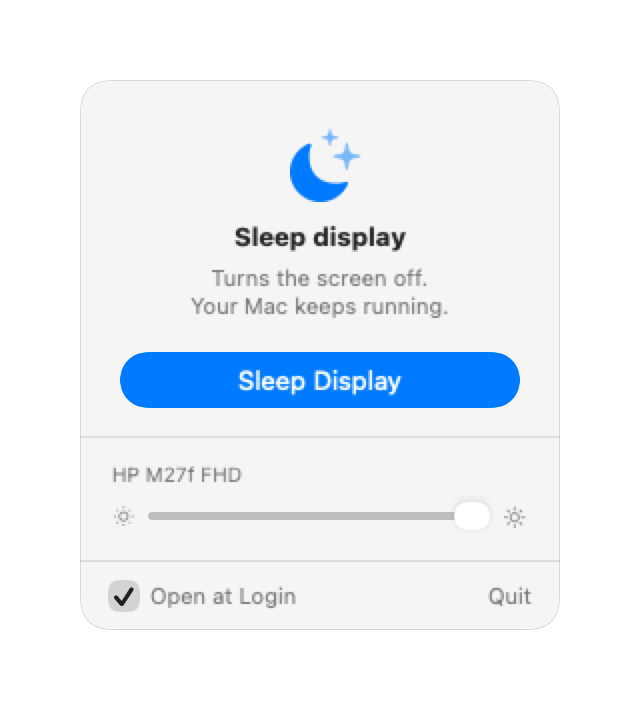

<div align="center">


# ScreenOff

**Turn off your Mac's screen from the menu bar with one click, and change the brightness of any monitor.**
Your Mac keeps running: downloads, music and builds carry on while the display sleeps.

[**Download ScreenOff for macOS**](https://github.com/codeclawd/screenoff-mac/releases/latest/download/ScreenOff.dmg)

Free and open source · macOS 14 or later · Apple silicon and Intel · under 1 MB

<picture>
  <source media="(prefers-color-scheme: dark)" srcset="docs/panel-dark.png">
  
</picture>

</div>

## Install

1. Download [ScreenOff.dmg](https://github.com/codeclawd/screenoff-mac/releases/latest/download/ScreenOff.dmg) and open it.
2. Drag **ScreenOff** into **Applications**.
3. Open ScreenOff from Applications. A power icon appears in your menu bar.

ScreenOff isn't notarized by Apple, so macOS blocks it the first time you open it. Close that message, go to **System Settings → Privacy & Security**, scroll down and click **Open Anyway**. You only do this once.

If you prefer Terminal, this does the same thing:

```sh
xattr -dr com.apple.quarantine /Applications/ScreenOff.app
```

## Use it

Click the power icon, then **Sleep Display**. Move the mouse or press a key to wake the screen.

Drag a display's slider to change its brightness. This works on external monitors too, which macOS can't dim on its own. ScreenOff talks to the monitor over the cable (DDC/CI), the same way the monitor's own buttons change it.

Tick **Open at Login** in the panel to start ScreenOff with your Mac. Press Esc or click elsewhere to close the panel.

## Why it doesn't wake right back up

Putting a display to sleep with a click is harder than it sounds, because any input wakes it again. ScreenOff handles the two cases that trip up a plain `pmset displaysleepnow`:

- It waits until your hand leaves the mouse and keyboard before it sleeps the screen.
- A finger resting on a Magic Mouse sends touch events that wake the display without moving the pointer. ScreenOff watches for a few seconds after sleeping and puts the screen back to sleep if nothing you did on purpose woke it.

## FAQ

**How do I turn off my Mac's display without putting the Mac to sleep?**
Click **Sleep Display** in ScreenOff. It runs Apple's `pmset displaysleepnow`, which sleeps only the screen. You can also type that command in Terminal.

**Does it need admin rights or special permissions?**
No. Any user can run `pmset displaysleepnow`. ScreenOff asks for no permissions.

**Will my Mac lock when the screen turns off?**
That follows your setting in **System Settings → Lock Screen → Require password after screen saver begins or display is turned off**. ScreenOff doesn't change it.

**Why is there no slider for my monitor?**
External monitor brightness needs an Apple silicon Mac and a monitor with DDC/CI turned on (check its on-screen menu). Some USB-C docks, DisplayLink adapters and TVs don't pass DDC through. The built-in display of a MacBook always gets a slider.

**My menu bar manager hides the icon.**
Drag the icon into the visible section of Bartender, Ice or Thaw. With the icon hidden, the panel opens at the top right of the screen.

## Build from source

You need the Xcode command line tools (`xcode-select --install`).

```sh
git clone https://github.com/codeclawd/screenoff-mac.git
cd screenoff-mac
./build.sh       # build/ScreenOff.app
./make-dmg.sh    # build/ScreenOff.dmg
```

The app is about 500 lines of Swift and SwiftUI with no dependencies. `Sources/main.swift` runs the menu bar item and the sleep logic. `Sources/Brightness.swift` handles brightness. `Sources/PanelView.swift` draws the panel.

## Credits

External monitor brightness follows the DDC method from [MonitorControl](https://github.com/MonitorControl/MonitorControl) (MIT License). If you want keyboard brightness keys, volume control and more per-monitor settings, use MonitorControl.

## License

MIT. See [LICENSE](LICENSE).
